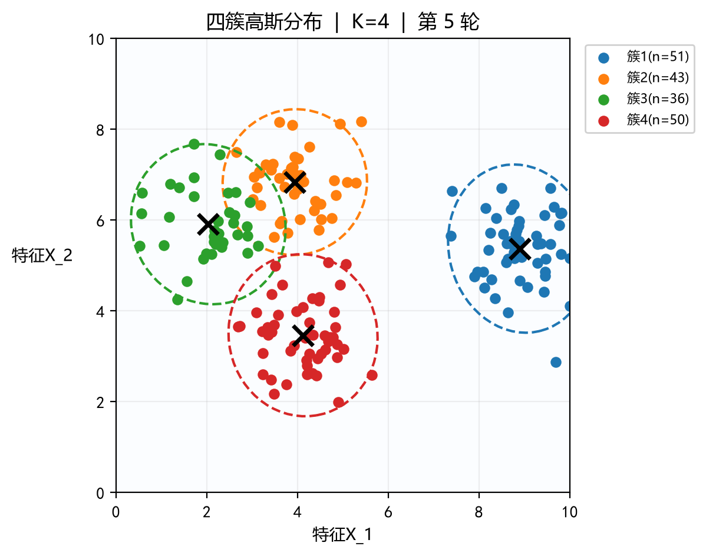
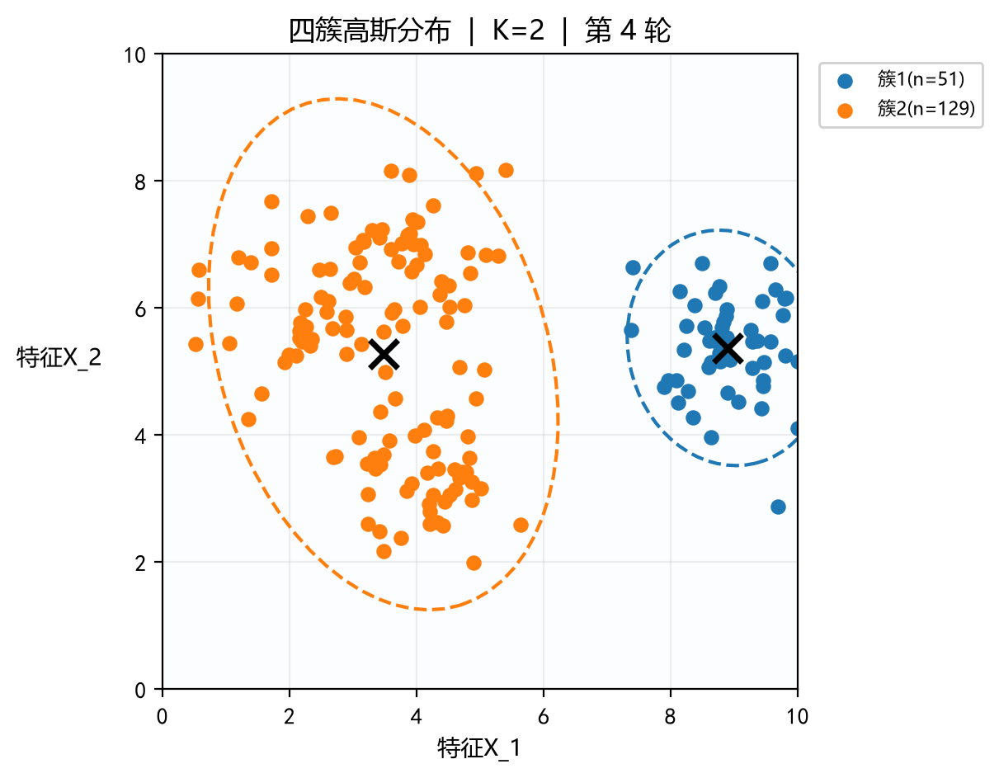
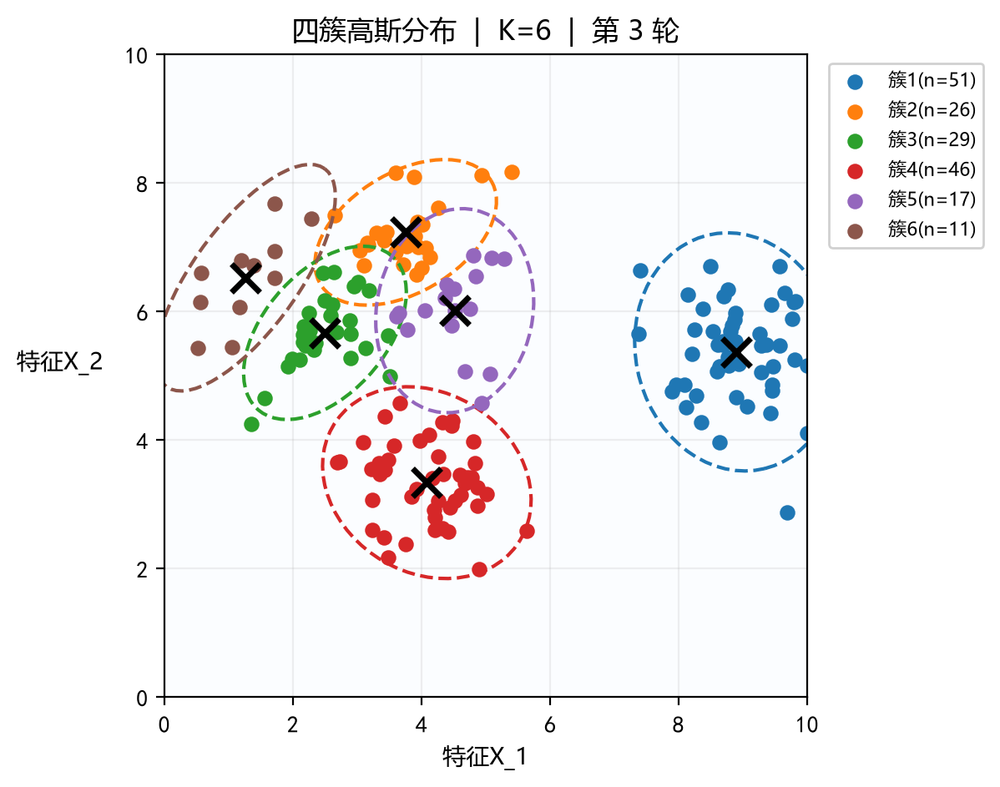
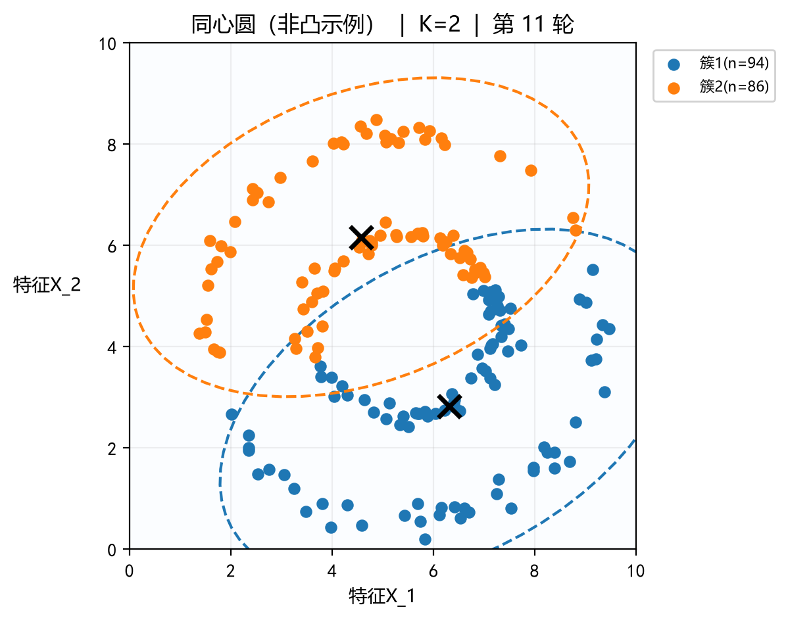

# 操作手册（K-Means Lab）

> 负责人：庞照阳

## 一、启动程序

```bash
python K-means.py
```

需要 Python 3.8+、NumPy、Matplotlib（Tkinter 随 Python 自带）。若依赖缺失，先执行 `pip install numpy matplotlib`。

## 二、界面分区

程序主窗口分为左右两部分：左侧是可滚动的控制栏，右侧是指标卡、画布与状态栏。

| 区域 | 位置 | 作用 |
|---|---|---|
| 实验设置 | 左上 | 选择数据形状、簇数 K、初始质心方式、样本数、随机种子、数据离散程度 |
| 运行算法 | 左中 | 连续运行 / 暂停（空格）、单步迭代（→）、重新初始化质心、在图上手动放置质心（Esc 取消） |
| 分析工具 | 左下 | K 值分析（肘部法 + 轮廓系数）、导出 CSV |
| 指标卡 | 右上 | 迭代轮数、簇内平方和（SSE）、轮廓系数、有效簇数 |
| 画布 | 右中 | 散点按簇着色，黑色叉号为质心，彩色虚线为各簇 95% 置信椭圆，箭头表示本轮质心位移 |
| 结果与提示 | 左下 | 每个簇的样本数与质心坐标；算法要点与停止条件说明 |
| 状态栏 | 右下 | 当前操作提示、数据集特点、SSE 相对初始状态的下降比例 |

## 三、画布显示说明

以「四簇高斯分布、K=4、种子 42」为例，程序跑至收敛（第 5 轮）后的画布如下：



- **散点颜色**表示所属簇，图例中同时给出该簇的样本数；
- **黑色叉号**为该簇当前的质心位置（簇内样本坐标的均值）；
- **彩色虚线椭圆**为该簇的 95% 置信椭圆，由样本协方差矩阵的特征分解得到，能直观反映簇的形状和延展方向；
- **标题**显示当前数据集、K 值与已迭代轮数。

## 四、三个典型实验

### 实验 1：改 K 看欠聚类与过聚类

操作：数据形状选「四簇高斯分布」，样本数 180，种子 42，分别取 K=2 / 4 / 6，各自跑至收敛。

| K | 收敛轮数 | SSE | 平均轮廓系数 | 现象 |
|---|---|---|---|---|
| 2 | 4 | 557.17 | 0.617 | 欠聚类：四个真实簇被合并成两个大簇 |
| 4 | 5 | 168.61 | 0.578 | 与数据真实结构一致 |
| 6 | 3 | 134.90 | 0.525 | 过聚类：真实簇被额外切开，SSE 继续下降但簇不再有含义 |

"欠聚类"（K=2）与"过聚类"（K=6）的画布对比：





**观察结论：**

1. SSE 随 K 增大单调下降，因此 **SSE 不能直接用来选 K**——K 等于样本数时 SSE 为 0 却毫无意义；
2. 本组数据上轮廓系数在 K=2 时最高（0.617），但 K=2 明显欠聚类，说明**轮廓系数偏向簇少而分离度高的划分**，需要与肘部法、业务可解释性结合判断；
3. 正确的 K 值判断应看"SSE 下降速度的拐点"（肘部）与"簇的语义可解释性"，而不是单一指标的最优值。

### 实验 2：两种初始化方式的差别

1. 固定种子（如 42），K=3，先用「K-means++」跑到收敛，记下迭代轮数与最终 SSE；
2. 换「随机」再跑一次，比较轮数和 SSE；
3. 把种子依次改成 1、7、13 重复，观察随机初始化是否陷入局部最优。

**观察结论：** K-means++ 通过"按 D(x)² 概率挑选彼此远离的初始质心"，通常能用更少的轮数得到更低的 SSE；随机初始化在某些种子下会把两个真实簇的质心都放在同一簇内，最终收敛到较差的局部最优。这也是算法对初始值敏感的直接证据。

### 实验 3：K-means 为什么搞不定同心圆

操作：数据形状选「同心圆（非凸示例）」，K=2，跑至收敛（本例需 11 轮，SSE=936.53，轮廓系数 0.368）。



**观察结论：** 分界线是一条直线，内外两圈被从中间切开，而不是按圆环分开。原因是 K-means 以"到质心的欧氏距离"划分样本，隐含假设簇是凸的、各向同性的；同心圆属于非凸结构，需要 DBSCAN、谱聚类这类基于密度或连通性的算法。同理，笑脸轮廓也会被直线边界切断。

## 五、结果导出

- **导出 CSV**：列为 `x, y, cluster, centroid_x, centroid_y`，簇号从 1 开始，UTF-8 BOM 编码，Excel 直接打开不乱码。
- **保存图像**：支持 PNG / PDF / SVG / EPS，200 dpi。
- **手动放置质心**：点击按钮后在图内依次点击 K 个位置，按 Esc 可取消；放满 K 个后自动接管为初始质心，迭代计数清零。

## 六、常见问题

| 现象 | 原因 / 处理 |
|---|---|
| 中文显示成方块 | 系统缺 `SimHei` / `微软雅黑`；在 `kmeans_lab/view.py` 顶部的 `rcParams` 里换成本机已有的字体 |
| 点「连续运行」没反应 | 算法已收敛，或正处于手动放置质心模式；先「重新初始化质心」或按 Esc |
| SSE 不再下降 | 正常收敛，状态栏会提示在第几轮满足停止条件 |
| 轮廓系数显示 N/A | 有效簇数小于 2，或某个簇只剩一个样本 |
| 想换一组数据 | 修改「随机种子」后点「生成数据 / 应用设置」，相同参数可复现同一批数据 |
